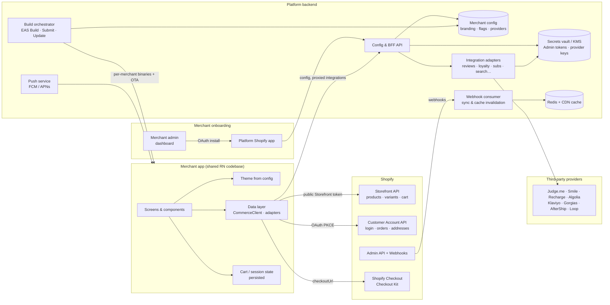

# Shopify Store → Mobile App Platform: Architecture & Integration Plan

This document covers **Task 1** (platform architecture and third-party integration plan) and explains how the **Task 2** prototype in this repo puts that architecture into practice.

---

## 1. Goals

- **One React Native codebase** that produces a separate branded Android and iOS app for each merchant.
- **Per-merchant differences are configuration**, not forks: branding, catalog entry points, feature flags and which third-party providers are enabled.
- **Third-party Shopify apps plug in through adapters** with one shared interface per category (reviews, loyalty, and so on), so each provider is written once and reused by every merchant who uses it.
- **Native app behavior is never assumed to work just because the website does.** Every integration gets a declared support level and a fallback.

---

## 2. High-level architecture



**Rules of the data flow**

1. The app talks to Shopify **directly** for catalog, cart and customer data. It uses only *public* credentials: a Storefront API token and a Customer Account API public client.
2. Anything that needs a **secret** goes through the platform backend: Admin API calls, private keys for third-party providers, and webhooks. The backend proxies those calls and stores secrets in a vault. Secrets never ship in the app binary.
3. **Checkout always happens on Shopify** (Checkout Kit or a web checkout). The app never handles card data.

---

## 3. Shared codebase with store-specific branding and configuration

Every merchant app is built from the same code. A merchant is described by a single **store config** document (`src/config/stores/<id>.json` in the prototype; in production it's served from the platform backend and has a schema version).

| Layer | Responsibility | Prototype location |
|---|---|---|
| Config | Store identity, build metadata, branding tokens, catalog entry points, feature flags, enabled integrations | `src/config/` |
| Theme | Turns branding tokens into colors, radius, heading style. Screens read only from the theme, never from raw hex values | `src/theme/` |
| Data layer | `CommerceClient` interface with a Shopify Storefront implementation and a mock one. Screens never call `fetch` | `src/data/commerce/` |
| Integration adapters | One interface per category, with a provider implementation and a declared failure mode | `src/data/integrations/` |
| State | Cart and app state, persisted per store and reconciled against Shopify | `src/state/` |
| Screens | Generic, config-driven UI | `src/app/`, `src/components/` |

### What is configurable vs. needs a build vs. needs custom development

| Change | Mechanism | Examples |
|---|---|---|
| **Runtime config** (no build, no OTA) | Fetched from config API at launch and cached | Colors, copy, hero banners, home collection, feature flags (free-shipping bar, reviews on/off), enabling or disabling a provider that's already supported, swapping a provider's account or keys |
| **OTA update** (EAS Update, JS-only) | New JS bundle published to the merchant's channel | New screen layouts or components, new provider adapters written in JS, bug fixes |
| **New native build** | EAS Build + store review | App name, bundle ID, icon, splash, URL scheme, push entitlements, new native SDKs (e.g. Klaviyo or Firebase native modules), permissions (camera, location), RN/Expo upgrades |
| **Custom development** | Engineering work, then shipped through the above | An unfamiliar third-party app with no API, bespoke theme logic (custom Liquid sections, product configurators), merchant-specific business rules, an integration that needs a native SDK we don't have yet |

---

## 4. Merchant onboarding, Shopify authorization and credential handling

1. **Install.** The merchant installs the platform's Shopify app (a public app with a Partner account) through the standard OAuth authorization-code grant. The platform requests the minimum Admin scopes it needs (`read_products`, `read_inventory`, `read_orders`, `unauthenticated_*` for Storefront token creation, and `write_storefront_access_tokens` or the Headless channel).
2. **Credentials.**
   - **Admin API access token**: stored encrypted (KMS envelope encryption) in the backend vault, scoped per shop. It's never sent to the device.
   - **Storefront API public token**: created per shop via the Admin API (or the Headless sales channel). It's public by design (rate-limited per buyer IP) and is delivered to the app through remote config, so it can be rotated without a build.
   - **Customer Account API**: a public client ID used for OAuth 2.0 + PKCE login inside the app. Refresh tokens are kept in `expo-secure-store` (Keychain/Keystore).
   - **Third-party provider keys** (e.g. Judge.me private token, Smile private key, Recharge API token): entered in the merchant dashboard, stored in the vault, and used only by backend adapters. The app calls `GET /v1/{shop}/reviews/{productId}`, never the provider directly with a secret.
3. **Webhooks.** These are registered on install: `products/*`, `inventory_levels/update`, `collections/*`, `app/uninstalled`, plus the mandatory GDPR webhooks `customers/data_request`, `customers/redact` and `shop/redact`. `app/uninstalled` revokes tokens and disables the merchant's config.
4. **Dashboard.** The merchant configures branding, picks providers per category, previews the result in a hosted preview build (Expo dev client or web preview) and requests a store build.

---

## 5. Shopify APIs used

| Domain | API | Operations |
|---|---|---|
| Products, collections, variants | Storefront API | `collection(handle)`, `product(handle)`, `nodes(ids)` for variant revalidation, `search`, `predictiveSearch` |
| Cart | Storefront API Cart | `cartCreate`, `cartLinesAdd`, `cartLinesUpdate`, `cartLinesRemove`, `cartDiscountCodesUpdate`, `cartBuyerIdentityUpdate`, `cart(id)` |
| Customer accounts | Customer Account API | OAuth PKCE login, `customer { orders, addresses }`, order status and fulfillments |
| Checkout | `cart.checkoutUrl` + **Shopify Checkout Kit** (`@shopify/checkout-kit-react-native`) | `present(checkoutUrl)`; listens for `complete` / `fail` / `dismiss` |
| Back office | Admin API (backend only) | Storefront token creation, metafields for app config, webhooks, selling plans read |

All GraphQL operations used by the prototype are in [`src/data/commerce/shopify/operations.ts`](src/data/commerce/shopify/operations.ts). They target Storefront API version `2026-10` (configurable through `SHOPIFY_API_VERSION`).

### How checkout works in production

1. The cart lives on Shopify. The app keeps only the `cartId` (persisted) and an optimistic local copy for instant UI.
2. Every cart mutation (`cartLinesAdd`/`Update`/`Remove`) returns the authoritative cart: prices, discounts, availability. The local copy is replaced with that response.
3. When the customer is logged in, `cartBuyerIdentityUpdate` attaches their customer access token, so checkout is pre-filled.
4. **Checkout** → `ShopifyCheckout.present(cart.checkoutUrl)` opens Shopify's own checkout natively (Checkout Kit). Shopify Payments, Shop Pay, Apple Pay and Google Pay, shipping, taxes, discount codes, gift cards and the merchant's checkout extensions all work there unchanged.
5. On the `complete` event the app clears the `cartId`, shows a confirmation screen and fires analytics. On `fail` or `dismiss` the cart is kept.
6. If Checkout Kit isn't available, the fallback is `expo-web-browser` with `checkoutUrl`, which is what the prototype's live-store path does.

The prototype keeps the cart locally, revalidates prices and availability against Shopify (`nodes(ids)`) whenever the cart screen gains focus and before checkout, and calls `cartCreate` when checkout starts. In sample-data mode the last step opens a labelled "Sample checkout" screen.

---

## 6. Backend, caching, synchronization and integration adapters

**Backend services** (Node/TypeScript, serverless or containers):

- **Config API**: serves versioned store config by `storeId` and app version, with a signed ETag. The app caches the last good config and starts offline with it.
- **BFF / integration proxy**: hosts the adapters, holds the provider secrets and normalizes responses into the platform's own types (`ReviewSummary`, `LoyaltyBalance`, …).
- **Webhook consumer**: verifies HMAC and pushes events to a queue. Workers invalidate the CDN and Redis keys (`product:{shop}:{handle}`, `collection:{shop}:{handle}`).
- **Push service**: stores device tokens per shop and customer, and sends through FCM/APNs (or Klaviyo when the merchant uses it).
- **Build orchestrator**: turns a config into an EAS Build job and tracks submissions.

**Caching strategy**

| Data | Where | TTL / invalidation |
|---|---|---|
| Store config | Device (persisted) + CDN | Stale-while-revalidate, version-pinned |
| Catalog (collections, products) | Device memory cache (TanStack Query) + optional CDN-cached BFF | 5 min, invalidated by webhook |
| Price & availability | Never trusted from cache at decision points | Revalidated on cart view, on add-to-cart and before checkout |
| Cart | Shopify (source of truth) + local optimistic copy | Replaced by every mutation response |
| Third-party data (reviews, loyalty balance) | BFF Redis | Reviews: 15 min. Loyalty: per request, short TTL |

**Adapter pattern.** Each category has one TypeScript interface, provider implementations and a registry keyed by config:

```ts
interface ReviewsAdapter {
  providerName: string;
  getProductReviews(productId: string): Promise<ReviewSummary>;
}
// registry: config.integrations.reviews.provider → adapter instance (or null when disabled)
```

The UI depends only on the interface and on three states: **loading, success, and unavailable**. Every adapter has to degrade to "unavailable" without blocking the shopping journey. The prototype's `ReviewsSection` with `MockJudgeMeAdapter` shows this: one store renders reviews, the other simulates a provider outage and shows a non-blocking fallback with a retry.

---

## 7. Building, releasing and updating merchant apps

- **One repo, many apps.** `app.config.ts` reads the `STORE` env var, loads that merchant's config, and sets name, slug, bundle ID or package, scheme, icon and splash. `STORE=verde eas build` produces the Verde Yoga app without touching any screen.
- **EAS Build profiles** per merchant (`development`, `preview`, `production`), generated from the config. CI runs a build matrix over merchants.
- **Signing and accounts.** Each app is published under the **merchant's own** Apple and Google developer accounts (Apple Guideline 4.2.6 rejects template apps submitted under one shared account). EAS manages credentials per merchant.
- **EAS Submit** to TestFlight and the Play internal track, then a staged rollout.
- **OTA updates.** EAS Update with one channel per merchant and environment and the `fingerprint` runtime-version policy, so a JS update only reaches binaries with a compatible native layer. Platform-wide fixes are published to every merchant channel in one job.
- **Versioning.** The config schema has a version, and the app ignores config fields it doesn't understand. Minimum app version enforcement (a force-update prompt) is driven by the config.

---

## 8. Third-party compatibility research

**Support levels**

- 🟢 **Shopify-native**: works through Shopify APIs or checkout with no extra integration.
- 🔵 **Reusable provider integration**: platform-built adapter or SDK, written once and enabled per merchant by config.
- 🟡 **Web-based fallback**: provider's hosted page or widget in a WebView or in-app browser.
- 🔴 **Unsupported**: not available in-app. The UI hides it or deep-links to the website.

| Category | Integration/provider | Recommended approach | Fastest implementation | Failure or fallback | Docs |
|---|---|---|---|---|---|
| Reviews | **Judge.me** | 🔵 Backend adapter calls the Judge.me REST API with the private token, then native list and star summary. Review submission goes through the API too | Read-only summary and reviews via proxy (the prototype's interface) | Hide the stars and show "Reviews unavailable", which doesn't block add-to-cart. 🟡 Submission can use Judge.me's hosted review form | [Judge.me API](https://judge.me/api/docs) |
| Loyalty | **Smile.io** | 🔵 Backend adapter with the Smile REST API (customer points, VIP tier, redeem rewards → discount code), then applied with `cartDiscountCodesUpdate` | Show the points balance plus a "Redeem" action that creates a discount code | 🟡 Open the Smile panel on the web storefront in a WebView, or hide the balance | [Smile developer docs](https://docs.smile.io/), [cartDiscountCodesUpdate](https://shopify.dev/docs/api/storefront/latest/mutations/cartDiscountCodesUpdate) |
| Subscriptions | **Recharge** (on Shopify selling plans) | 🟢 Purchase: render `sellingPlanGroups` from the Storefront API and pass `sellingPlanId` in cart lines. Checkout is native Shopify. 🔵 Manage subscriptions through the Recharge API via backend | Selling-plan picker on the product page plus native checkout | 🟡 Subscription management uses the Recharge customer portal in a WebView | [Shopify subscriptions](https://shopify.dev/docs/apps/build/purchase-options/subscriptions), [Recharge API](https://developer.rechargepayments.com/) |
| Search | **Shopify Search & Discovery** (Algolia when the merchant uses it) | 🟢 Storefront API `search` and `predictiveSearch` respect Search & Discovery synonyms and filters. 🔵 Algolia adapter (public search-only key) for merchants on Algolia | `predictiveSearch` for type-ahead, `search` with filters for results | Fall back to Shopify native search if Algolia errors | [Storefront search](https://shopify.dev/docs/api/storefront/latest/queries/search), [Algolia docs](https://www.algolia.com/doc/) |
| Discounts / bundles | **Shopify discounts + Shopify Bundles** | 🟢 Automatic discounts and codes apply to the Storefront cart (`discountAllocations`). Bundles built with Shopify Bundles or Cart Transform functions resolve in cart and checkout | Discount-code field on the cart screen, plus showing `discountAllocations` | 🟡 Third-party bundle apps that rely on theme JS (e.g. widget-only "Buy X get Y" builders) need a WebView product page or are 🔴 unsupported until an adapter exists | [Cart discounts](https://shopify.dev/docs/storefronts/headless/building-with-the-storefront-api/cart/manage), [Bundles](https://shopify.dev/docs/apps/build/product-merchandising/bundles) |
| Notifications | **Klaviyo** (push + email) | 🔵 Klaviyo React Native SDK registers the push token and profile. Flows (abandoned cart, back in stock) run in Klaviyo. Requires a native build | `expo-notifications` + FCM/APNs through the platform push service for broadcast campaigns | Without Klaviyo, platform push only. Without push permission, Klaviyo email still works | [Klaviyo RN SDK](https://github.com/klaviyo/klaviyo-react-native-sdk), [Expo push](https://docs.expo.dev/push-notifications/overview/) |
| Analytics | **Firebase Analytics / GA4** + Shopify checkout events | 🔵 Shared analytics interface (`track('add_to_cart')`) with a Firebase implementation. 🟢 Checkout events come from Checkout Kit and Shopify web pixels | Firebase via `@react-native-firebase/analytics` | Events queue offline. Analytics failures are swallowed and never block the UI | [RN Firebase Analytics](https://rnfirebase.io/analytics/usage), [Checkout Kit](https://shopify.dev/docs/storefronts/mobile/checkout-kit) |
| Support | **Gorgias** | 🟡 Gorgias chat widget in a WebView (fastest, full features). 🔵 Later: native ticket form through the Gorgias REST API via backend | WebView chat screen with customer email injected | "Contact us" falls back to email (`mailto:`) and FAQ pages from Shopify `pages` | [Gorgias developers](https://developers.gorgias.com/) |
| Order tracking | **Shopify fulfillments** (AfterShip when used) | 🟢 Customer Account API orders → `fulfillments` → tracking number, company and URL. 🔵 AfterShip adapter for rich checkpoints | Order list plus a "Track" button opening the carrier tracking URL | 🟡 Open the AfterShip branded tracking page, or Shopify's order status page | [Customer Account API](https://shopify.dev/docs/api/customer), [AfterShip Tracking](https://www.aftership.com/docs/tracking) |
| Returns | **Loop Returns** | 🟡 Loop's hosted returns portal in a WebView, pre-filled with order number and email (Loop's flows are complex and change often) | WebView to the merchant's Loop portal URL from config | 🟢 Shopify self-serve returns through customer accounts when the merchant doesn't use Loop. Otherwise link to the returns policy page | [Loop developer docs](https://docs.loopreturns.com/) |

**Explicitly unsupported in-app (🔴) until custom work:** theme-only apps that inject Liquid or JS into the storefront with no API (popup builders, page builders such as Shogun or PageFly sections, size-chart widgets without data APIs), and checkout UI customizations that rely on the legacy `checkout.liquid`. These are shown on the website only, or rebuilt natively as custom development.

---

## 9. Handling an unfamiliar Shopify app or theme customization

1. **Identify what it touches.** Is the data in Shopify (metafields, metaobjects, selling plans, discounts, Functions), in the app's own backend, or only in theme JS/Liquid? Inspect the theme app extension, the network calls on the storefront, and the app's API docs.
2. **Classify it** with the support levels above:
   - Data in Shopify → 🟢 read it through the Storefront API (expose metafields and metaobjects to the Storefront API).
   - Documented API → 🔵 write an adapter behind the existing category interface. If no category exists, add one.
   - Widget-only → 🟡 WebView or in-app browser of the storefront page, with the session passed when needed.
   - Nothing usable → 🔴 hide it in the app and document it for the merchant.
3. **Spike for half a day** with a timebox. Ship the WebView fallback first so the merchant isn't blocked, then replace it with a native adapter if usage justifies the cost.
4. **Contract-test the adapter** with recorded responses, and add synthetic monitoring so a provider API change shows up before customers notice.
5. **Theme customizations** (custom sections, product configurators) are rebuilt as config-driven native components only when they're generic across merchants. Otherwise they stay web content or become a paid custom block.

---

## 10. Three biggest technical risks

| # | Risk | Mitigation |
|---|---|---|
| 1 | **Third-party app sprawl.** Every merchant uses different apps, many with no mobile API. Native parity fails and support costs explode | Category adapter interfaces plus a support-level matrix agreed during onboarding. WebView fallback is the default. Only build native adapters for the providers most merchants share (the top 2–3 per category). Contract tests and provider health monitoring |
| 2 | **Price, inventory and cart inconsistency** between the app cache, Shopify and checkout (stale prices, oversold variants, discounts not reflected) | Shopify cart is the source of truth. Revalidate before every decision point. Webhook-driven cache invalidation. Show `discountAllocations` from the cart response instead of computing them on the client. Checkout Kit guarantees final totals |
| 3 | **Release operations at scale.** Hundreds of binaries, signing credentials, App Store "template app" rejection (4.2.6), and native drift between merchants | Publish under each merchant's own developer account. Fully config-generated builds (no per-merchant code). EAS Build matrix with fingerprint runtime versions and OTA channels per merchant. Staged rollouts with crash monitoring (Sentry) and automatic rollback of OTA updates |

---

## 11. Recommended framework, libraries and tools

| Need | Choice | Why |
|---|---|---|
| Framework | **Expo (SDK 58) + React Native New Architecture + TypeScript** | Continuous Native Generation lets per-merchant native config come from `app.config.ts`. EAS Build, Submit and Update cover the release pipeline |
| Navigation | **Expo Router** | File-based routes, typed routes, deep links per merchant scheme |
| Server state | **TanStack Query** (prototype uses a minimal `useAsync`) | Caching, retries, background refetch, offline persistence |
| Client state | **Zustand** + `persist` (AsyncStorage) | Small and fast. Used for the cart and app flags in the prototype |
| GraphQL | `graphql-codegen` against the Storefront schema, with typed documents | Type-safe operations and version upgrades checked at compile time |
| Shopify | **Checkout Kit RN**, Storefront API, Customer Account API, `@shopify/flash-list` | Native checkout and fast lists |
| Images | `expo-image` with Shopify CDN `?width=` transforms | Caching, blur placeholders |
| Secure storage | `expo-secure-store` | Customer tokens in Keychain/Keystore |
| Push | `expo-notifications` (+ Klaviyo SDK when used) | |
| Quality | ESLint (`eslint-config-expo`), Jest + React Native Testing Library, Maestro E2E, Sentry | |
| AI acceleration | Claude Code for scaffolding, adapters and docs. GraphQL codegen to avoid hand-written types | |

---

## 12. Prototype (Task 2): how it applies this architecture

```
app.config.ts                 STORE env → per-merchant name, bundle ID, scheme, splash
src/config/stores/*.json      Store configs (ATHLX = Gymshark-style reference, Verde Yoga = second fictional store)
src/config/index.ts           Resolves the active store at runtime; SHOPIFY_* env switches to a live store
src/theme/                    Branding tokens → theme used by every component
src/data/types.ts             Platform domain types (Product, Variant, Money…)
src/data/commerce/            CommerceClient interface
  shopify/                    Storefront GraphQL operations + client
  mock/                       Labelled sample data, latency, simulated failure
src/data/integrations/reviews Reviews adapter interface + mocked Judge.me (success / outage)
src/state/cart.ts             Persisted cart (AsyncStorage, namespaced per store) + reconcile()
src/app/                      Screens: welcome → home → product → cart → (sample) checkout
src/components/               Reusable UI that reads only from theme and props
```

**Requirement coverage**

| Requirement | Implementation |
|---|---|
| Branded welcome with skip | `src/app/index.tsx`: slides from config, Skip and Next/Start, remembered per store |
| Home / collection with sample products | `src/app/home.tsx`: hero from config, 2-column grid, badges (Sale, Bestseller, Sold out) |
| Product details with variant selection and an unavailable option | `VariantSelector` + `utils/variants.ts`: sold-out values are struck through, non-existent combinations are disabled (e.g. Arrival Shorts *Navy / XS*), a low-stock message appears, and the CTA reflects the state (Select size, Sold out, Unavailable, Max quantity in bag) |
| Cart with quantity, remove, checkout | `src/app/cart.tsx`: stepper capped by `quantityAvailable`, remove, subtotal, checkout |
| Consistent variants, prices, availability | Cart lines store `variantId` and are revalidated (`getVariants` → `reconcile`) on focus and before checkout. Unavailable lines block checkout |
| Cart persistence after restart | Zustand `persist` + AsyncStorage, key `cart:<storeId>`. A hydration gate in `_layout.tsx` avoids a flash of an empty cart |
| Loading, error/retry, empty cart | `StateViews` (`LoadingView`, `ErrorView` with retry, `EmptyView`). Run with `--simulate-errors` to force the first request to fail |
| Store config controls branding + one optional feature | `branding.*` drives the theme. `features.freeShippingThreshold` turns the free-shipping progress bar on for ATHLX ($75) and off for Verde (`null`) |
| Second store without editing screens | `npm run store:verde`: different name, bundle ID, colors, radius, typography casing, locale and currency (GBP), catalog and welcome copy |
| Mocked third-party integration, success + unavailable | `MockJudgeMeAdapter`: ATHLX shows reviews (success). Verde has `simulateOutage: true` and shows the non-blocking "Reviews are unavailable" fallback with Retry |
| Storefront GraphQL operations | `src/data/commerce/shopify/operations.ts` (products, product, variant revalidation, cart create, lines add/update/remove, discount codes, buyer identity) |
| Data layer separate from UI | Screens import only `commerce` (interface) and `reviews` (adapter). Switching mock ↔ Shopify is configuration only |

---

## 13. Submission notes

- **Platforms tested:** see `README.md` → *Platforms tested*.
- **AI tools used:** Claude Code (Claude Opus) for scaffolding, implementation, browser-based verification and documentation.
- **Issues corrected during development:**
  1. The cart subtotal was a Zustand selector that returned a new object on every call. With Zustand v5 and React 19 that caused a "Maximum update depth exceeded" crash on add-to-cart. It was replaced with a memoized `useSubtotal()` hook over the stable `lines` array.
  2. The first checkout used `Alert.alert` with buttons, which does nothing on react-native-web. It was moved to a dedicated `/checkout` modal route so the flow behaves the same on every platform.
  3. Expo's config loader can't import TypeScript modules from `app.config.ts`, so store configs became JSON. That also matches how they'd be served from the config API.
- **Unfinished / next steps:** live Shopify dev store not connected (the Storefront client is implemented but only exercised with sample data); server-synced cart (`cartLinesAdd` etc.) wired to the UI; Checkout Kit integration (needs a dev build); customer login (Customer Account API); real product imagery; automated tests (Jest + Maestro); TanStack Query in place of `useAsync`; a remote config API.
